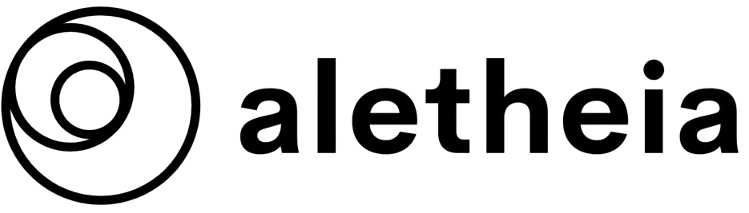
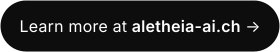

  <picture>
    <source media="(prefers-color-scheme: dark)" srcset="logo/logo_white.png">
    <source media="(prefers-color-scheme: light)" srcset="logo/logo_black.png">
    
  </picture>

## What is Aletheia?

Aletheia is an **automated financial newsroom for wealth managers**. Several times a
day it reads the market news, discards the noise, groups what remains by the
underlying event, and matches it against every position in a client portfolio.

The output: what happened, why it matters for *this* book, and what to watch next,
with every claim traced back to its sources.

---

## The Problem

Advisors and portfolio managers start every day the same way: dozens of tabs,
overlapping headlines, and no fast answer to the only question that matters. *Does
any of this move my positions?*

- News volume vastly exceeds what one person can read before the open
- The same event arrives ten times from ten outlets, in ten shapes
- Connecting a macro headline to a specific holding is manual work, repeated daily
- Generic AI assistants are unreliable on recent news and can't see the portfolio
- Client-facing commentary, from monthly reports to position notes, is still written by hand

---

## What Aletheia Does

- **Morning Brief:** the day's market events, ranked and organised by region, each one sourced
- **Position Impact:** one clear read per holding, built from the day's events and a fresh, position-specific search
- **Weekly Brief:** related events chained across days into stories, and stories grouped into the bigger picture
- **Reports:** position one-pagers on demand and an automatic monthly portfolio brief, white-labelled for the advisor's firm

Available in English & German.

---

 

  <a href="https://aletheia-ai.ch">
    <picture>
      <source media="(prefers-color-scheme: dark)" srcset="assets/learn-more-dark.svg">
      <source media="(prefers-color-scheme: light)" srcset="assets/learn-more-light.svg">
      
    </picture>
  </a>

 

  The application code is private. This repository holds the brand assets.

